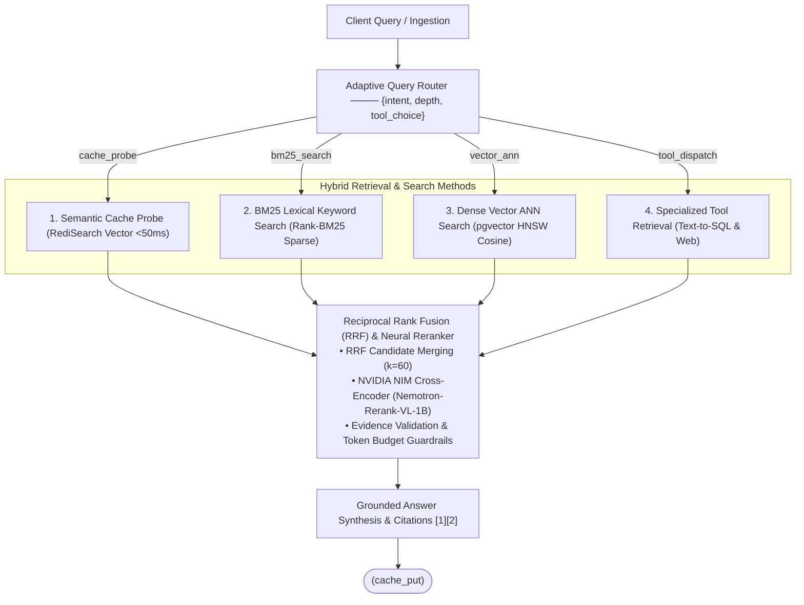

# Agentic RAG V1

<p align="center">
  <strong>Autonomous Multi-Tier Hybrid Retrieval, Semantic Caching & Grounded Context Synthesis</strong>
</p>

<p align="center">
  
  
  
  
  
  
  
</p>

---

## 🏛️ System Architecture

<p align="center">
  
</p>

The **Adaptive Agentic RAG** engine combines dynamic query routing, multi-method hybrid retrieval, reciprocal rank fusion (RRF), neural cross-encoder re-ranking, and high-speed semantic vector caching with end-to-end OpenTelemetry tracing.

### Architectural Breakdown



1. **Client Action / Query**: Tenant-scoped payloads arrive via REST API, file upload, or CLI with authenticated access control lists (`ACL`), request context timestamps, and token budgets.
2. **Adaptive Query Router**: Inspects query intent, complexity, and domain scope to determine execution depth (`parametric`, `single_hop`, `multi_hop`) and tool choice (`vector`, `sql`, `web`, `parametric`), with policy-driven confidence escalation.
3. **Hybrid Retrieval & Search Methods**:
   - **Method 1: Semantic Cache Probe**: High-velocity RediSearch vector cosine distance check. If similarity meets `CACHE_SIMILARITY_THRESHOLD`, queries achieve a **sub-50ms cache hit**, immediately bypassing downstream retrieval and synthesis.
   - **Method 2: BM25 Lexical Keyword Search**: Exact-match keyword scoring using `rank-bm25`. Crucial for identifiers, error codes, and domain acronyms. Indexes are dynamically invalidated per tenant upon document ingestion.
   - **Method 3: Dense Vector ANN Search**: High-recall semantic vector similarity powered by PostgreSQL with `pgvector` HNSW indexes and asymmetric embeddings (`input_type="passage"` for ingestion, `"query"` for retrieval).
   - **Method 4: Specialized Tool Retrieval**: Structured Text-to-SQL queries against relational databases, live Web Search tool execution, or multi-hop agentic graph traversal when deep reasoning is needed.
4. **Reciprocal Rank Fusion & Neural Reranker**:
   - Fuses ranked candidate lists from lexical and dense searches via Reciprocal Rank Fusion (`RRF k=60`).
   - Re-ranks top candidates using the **NVIDIA NIM Cross-Encoder** (`nvidia/llama-nemotron-rerank-vl-1b-v2`).
   - Applies evidence validation filters and strictly enforces context token budgets (`RETRIEVAL_CONTEXT_TOKEN_BUDGET`).
5. **Grounded Answer Synthesis**: Context assembly feeds into the generation engine (Meta LLaMA 3.1 8B Instruct / OpenAI GPT-4o-mini), enforcing strict inline evidence citations (`[1]`, `[2]`). Newly synthesized answers are asynchronously cached in Redis for future hits.
6. **Observability & Feedback Loop**: OpenTelemetry traces flow to **Arize Phoenix**. Query and retrieved content capture is a separate opt-in and is disabled by default.

---

## ⚡ Key Capabilities

- **Hybrid Lexical & Semantic Retrieval**: Seamlessly blends BM25 keyword precision with dense embedding recall, optimized via Reciprocal Rank Fusion (RRF).
- **Sub-50ms Semantic Caching**: Employs RediSearch vector indexes in Redis Stack to eliminate duplicate LLM calls and reduce latency by up to 90%.
- **Neural Cross-Encoder Re-Ranking**: Hosted NVIDIA NIM re-ranking (`llama-nemotron-rerank-vl-1b-v2`) with automatic order-preserving fallbacks.
- **Dynamic Index Invalidation**: Automatically updates tenant BM25 lexical caches upon ingestion completion, eliminating stale read states.
- **Provider Redundancy & Resilient Fallbacks**: Unified interfaces for NVIDIA NIM and OpenAI for embeddings, re-ranking, and text generation.
- **Deterministic Inline Citations**: Context assembly ensures generated responses cite source documents directly (`[1]`, `[2]`), mapping chunk IDs back to source documents.
- **Multi-Tenant Isolation**: Tenant-scoped database queries, Redis vector indexes, and access control contexts (`RequestContext`).
- **Interactive Web Dashboard**: Built-in visual console at `/dashboard` for testing document ingestion, real-time job tracking, and hybrid query verification.
- **Privacy-First Observability**: OTLP traces go to Arize Phoenix with query, answer, and retrieved-context capture disabled by default and credential redaction always enabled.

---

## 🛠️ Technology Stack

| Domain | Technology | Purpose |
| :--- | :--- | :--- |
| **API & Framework** | FastAPI, Uvicorn, Pydantic v2 | High-throughput asynchronous REST API |
| **Relational Database** | PostgreSQL 16 + `pgvector` | Chunk storage, metadata, and HNSW vector similarity |
| **Semantic Cache** | Redis Stack 7.2 (RediSearch) | Vector-similarity caching with cosine distance |
| **Search Engine** | Rank-BM25 & pgvector | Lexical search and dense vector ANN similarity |
| **Neural Models** | NVIDIA NIM / OpenAI | Nemotron embeddings, LLaMA 3.1 8B, Nemotron Rerank |
| **Observability** | Ariadne Phoenix, OpenTelemetry | OTLP distributed tracing, token profiling, latency metrics |
| **Migrations & ORM** | SQLAlchemy 2.0, Alembic | Declarative database schema and version control |

---

## 🚀 Quick Start

### Prerequisites

- [Docker](https://docs.docker.com/get-docker/) & [Docker Compose](https://docs.docker.com/compose/)
- Python 3.11+ and [`uv`](https://github.com/astral-sh/uv) (for local CLI development)
- NVIDIA NIM API Key or OpenAI API Key (optional for mock/deterministic tests)

### 1. Configure Environment

Copy the example configuration:

```bash
cp .env.example .env
```

Set your model provider credentials in `.env` (e.g. `NIMS_API_KEY` or `OPENAI_API_KEY`):

```dotenv
NIMS_API_KEY=nvapi-your-key-here
NIMS_EMBEDDING_MODEL=nvidia/llama-nemotron-embed-vl-1b-v2
NIMS_GENERATION_MODEL=meta/llama-3.1-8b-instruct
NIMS_RERANK_MODEL=nvidia/llama-nemotron-rerank-vl-1b-v2

# Semantic Cache
CACHE_ENABLED=true
CACHE_SIMILARITY_THRESHOLD=0.15
REDIS_HOST=redis
REDIS_PORT=6379

# Phoenix trace collection (content remains off unless explicitly enabled)
PHOENIX_ENABLED=true
PHOENIX_CAPTURE_CONTENT=false
PHOENIX_PROJECT_NAME=adaptive-rag
```

### 2. Launch Local Stack

Start all services with Docker Compose:

```bash
docker compose up --build
```

The stack provisions:
- **FastAPI Core**: [http://localhost:8000](http://localhost:8000)
- **Interactive Dashboard**: [http://localhost:8000/dashboard](http://localhost:8000/dashboard)
- **API Documentation**: [http://localhost:8000/docs](http://localhost:8000/docs)
- **Ariadne Phoenix Tracing**: [http://localhost:6006](http://localhost:6006)
- **PostgreSQL (pgvector)**: `localhost:5432`
- **Redis (RediSearch)**: `localhost:6379`

To shut down the stack:
```bash
docker compose down
# Use -v only if you intentionally wish to erase local database volumes:
docker compose down -v
```

### Phoenix traces and offline evaluations

The API and worker export safe trace metadata to the Phoenix service at
`http://phoenix:6006`; the local Phoenix UI is at `http://localhost:6006`.
`PHOENIX_ENABLED` controls trace export. `PHOENIX_CAPTURE_CONTENT` is an
independent setting that defaults to `false`. With content capture enabled,
traces include only the selected query, answer, and retrieved-context fields;
credentials and unrelated sensitive attributes remain redacted.

Content capture must be enabled when the API records the trace and again for the
explicit evaluator invocation. Set the Groq model and key in the ignored local
`.env` file, then run one selected trace:

```bash
docker compose --profile eval run --rm phoenix-eval \
  --project adaptive-rag --trace-id <trace-id>
```

Or choose a bounded time range of up to seven days:

```bash
docker compose --profile eval run --rm phoenix-eval \
  --project adaptive-rag --since 2026-10-15T00:00:00Z --until 2026-10-16T00:00:00Z
```

Set `PHOENIX_CAPTURE_CONTENT=true` and `PHOENIX_EVAL_GROQ_API_KEY` in `.env`
before running the command. The evaluator image and Phoenix SDK are built only
for this one-shot Compose profile. Phoenix faithfulness and document relevance
evaluators send selected trace content to the configured Groq endpoint only
during this explicit run. Phoenix may also retain evaluator input/output traces
in the configured project. CLI output contains only run identifiers, counts,
and sanitized status categories.

For a custom Phoenix server, set `PHOENIX_EVAL_API_BASE_URL` to a URL reachable
from the evaluator container. Its default is `http://phoenix:6006`; host-local
`localhost` URLs are not reachable from inside that container. This evaluator
URL is independent of the OTLP collector endpoint (`PHOENIX_ENDPOINT`).

Phoenix annotations do not calculate deterministic retrieval metrics. MRR,
recall@k, and nDCG keep their existing semantics, and Ragas remains an
independent offline evaluator with no score export to Phoenix.

---

## 📡 API Usage Examples

### 1. Ingest Documents

#### Option A: Submit Raw Content
```bash
curl -X POST http://localhost:8000/v1/ingestion \
  -H "Content-Type: application/json" \
  -H "x-tenant-id: default" \
  -d '{
    "filename": "rag_overview.md",
    "content": "Adaptive Agentic RAG pairs BM25 lexical search with pgvector dense similarity, re-ranking candidates using NVIDIA NIM cross-encoders.",
    "source_type": "upload",
    "metadata": {"category": "architecture"}
  }'
```

#### Option B: Upload a File
```bash
curl -X POST http://localhost:8000/v1/ingestion/upload \
  -H "x-tenant-id: default" \
  -F "file=@sample_document.txt" \
  -F 'metadata={"author":"admin"}'
```

#### Check Ingestion Job Status
```bash
curl http://localhost:8000/v1/ingestion/<JOB_ID>
```

### 2. Query the Engine

#### Hybrid Retrieval with Grounded Answer Synthesis
```bash
curl -X POST http://localhost:8000/v1/queries \
  -H "Content-Type: application/json" \
  -H "x-tenant-id: default" \
  -d '{
    "query": "How does Adaptive RAG handle re-ranking and caching?",
    "limit": 5,
    "generate": true
  }'
```

**Response**:
```json
{
  "query": "How does Adaptive RAG handle re-ranking and caching?",
  "answer": "Adaptive RAG utilizes a Redis RediSearch vector cache for sub-50ms semantic retrieval [1]. When cache misses occur, candidates from BM25 and dense stages are fused and re-ranked using an NVIDIA NIM cross-encoder [2].",
  "citations": [
    {
      "citation_index": 1,
      "document_id": "doc_9281a",
      "chunk_id": "chk_0392f"
    },
    {
      "citation_index": 2,
      "document_id": "doc_9281a",
      "chunk_id": "chk_0393a"
    }
  ],
  "cache_status": "miss",
  "trace_id": "93a02fe812bc"
}
```

Subsequent identical or semantically similar queries return `"cache_status": "hit"` in `<50ms`.

---

## 🖥️ Interactive Web Dashboard

Access the built-in control dashboard at **`http://localhost:8000/dashboard`**:

- **Document Uploader**: Drag & drop or upload text and markdown files with custom JSON metadata.
- **Ingestion Job Tracker**: Real-time progress monitoring through `parsing`, `normalization`, `chunking`, and `embedding` stages.
- **Adaptive Query Playground**: Test hybrid search with toggles for generation and configurable result limits.
- **Citation & Cache Badges**: Inspect generated answers, grounded citations, latency profiles, and cache hit/miss indicators.

---

## 📊 Offline RAG Evaluation with Ragas

Ragas evaluation is an explicit, offline workflow for scoring observations that you provide. It does not run the application's query pipeline, collect traces, or publish results to Phoenix. Install the optional evaluator dependencies when needed:

```bash
uv sync --extra eval
```

The judge uses Groq's OpenAI-compatible API. Set the key only in your local environment (never commit it); the endpoint and model can be overridden:

```dotenv
RAGAS_JUDGE_API_KEY=your-groq-api-key
# Optional overrides:
RAGAS_JUDGE_API_BASE=https://api.groq.com/openai/v1
RAGAS_JUDGE_MODEL=openai/gpt-oss-20b
```

For each labeled evaluation item, provide its generated response and the contexts actually returned by retrieval. `EvalItem.context` is not used by Ragas: `retrieved_contexts` comes only from the supplied observation and must contain the actual retrieved text. `EvalItem.gold_answer` is passed as the reference for context precision and context recall when present; it is not treated as a retrieved context. Empty or missing inputs make only the affected metrics not applicable.

```python
import asyncio
import json

from adaptive.config import get_settings
from adaptive.eval.datasets import load_dataset
from adaptive.eval.ragas_models import RagasObservation
from adaptive.eval.ragas_provider import build_ragas_metrics
from adaptive.eval.ragas_evaluator import evaluate_ragas


async def main():
    items = load_dataset("data/eval")
    observations = [
        RagasObservation(
            dataset_item_id=items[0].id,
            response="The answer produced for this evaluation item.",
            retrieved_contexts=["The text of the chunk actually retrieved."],
        ),
    ]

    # Pass the embedding provider already configured for this application.
    metric_set = build_ragas_metrics(get_settings(), configured_embedding_provider)
    report = await evaluate_ragas(
        items,
        observations,
        metric_set,
        evaluator_metadata={"model": "openai/gpt-oss-20b"},
    )
    print(json.dumps(report.model_dump(mode="json"), indent=2))


asyncio.run(main())
```

Replace `configured_embedding_provider` with the application's configured embedding provider. The evaluator uses that provider and its configured embedding model for response relevancy; Groq supplies the LLM judge for the other Ragas metrics. Keep observation text and credentials in the local evaluation environment and share only appropriately reviewed results.

### Establish a baseline first

Capture the first baseline only after collecting real responses and their actual retrieved contexts, and after configuring your Groq key. Review the resulting per-metric and aggregate scores before choosing any target. Do not create a baseline from the deterministic fake provider, reference contexts, or synthetic retrieval text. Ragas score thresholds are not part of CI; first establish and review a representative baseline, then decide whether a separate threshold proposal is appropriate.

---

## 🧪 Development & Quality Assurance

Run the test suite and static analysis in the Docker development image:

```bash
# Full unit and integration suite
docker compose --profile test run --rm test

# Lint and type checks in the same image
docker compose --profile test run --rm --entrypoint uv test run --frozen --group dev ruff check .
docker compose --profile test run --rm --entrypoint uv test run --frozen --group dev mypy adaptive

# Smoke test Compose configuration
docker compose config

# Build the serving and optional evaluator images
docker compose build api worker phoenix-eval
```

---

## 📂 Project Structure

```
.
├── adaptive/
│   ├── api/               # FastAPI endpoints, schemas, authentication, and dashboard
│   ├── cache/             # Redis RediSearch semantic vector cache store and service
│   ├── db/                # SQLAlchemy models, repositories, and connection sessions
│   ├── eval/              # RAG benchmarking, dataset sweeps, and metric evaluation
│   ├── graph/             # Agentic graph workflows and subgraph definitions
│   ├── guardrails/        # Evidence validation, token budgeters, and safety filters
│   ├── ingestion/         # Document parsing, normalization, chunking, and pipeline
│   ├── observability/     # OpenTelemetry configuration, span tracing, and redactors
│   ├── providers/         # NVIDIA NIM and OpenAI embedding, generation, & rerankers
│   ├── retrieval/         # BM25 lexical stage, NeonDB pgvector stage, and RRF fusion
│   ├── routers/           # Adaptive policy routers and model escalation handlers
│   ├── config.py          # Pydantic v2 application configuration and environment settings
│   └── interfaces.py      # Core domain models, protocols, and data contracts
├── alembic/               # Database migrations for schema evolution
├── docs/
│   ├── assets/            # Architecture diagrams (SVG & PNG)
│   ├── architecture.md    # In-depth architectural design specification
│   └── runbooks/          # Incident response and local deployment operational runbooks
├── tests/                 # Unit, integration, and smoke test suites
├── docker-compose.yml     # Local multi-service infrastructure definition
├── Dockerfile             # Multi-stage container build definition
└── pyproject.toml         # Project dependencies and tool configurations
```

---

## 📄 License

This project is licensed under the [MIT License](LICENSE).
